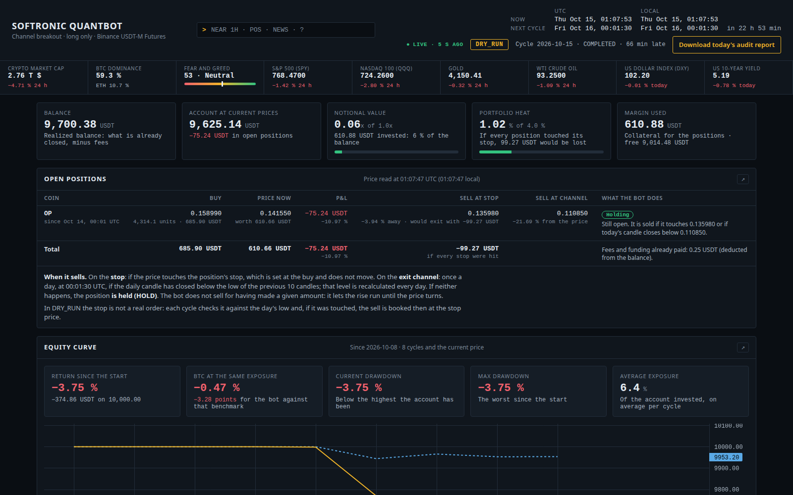
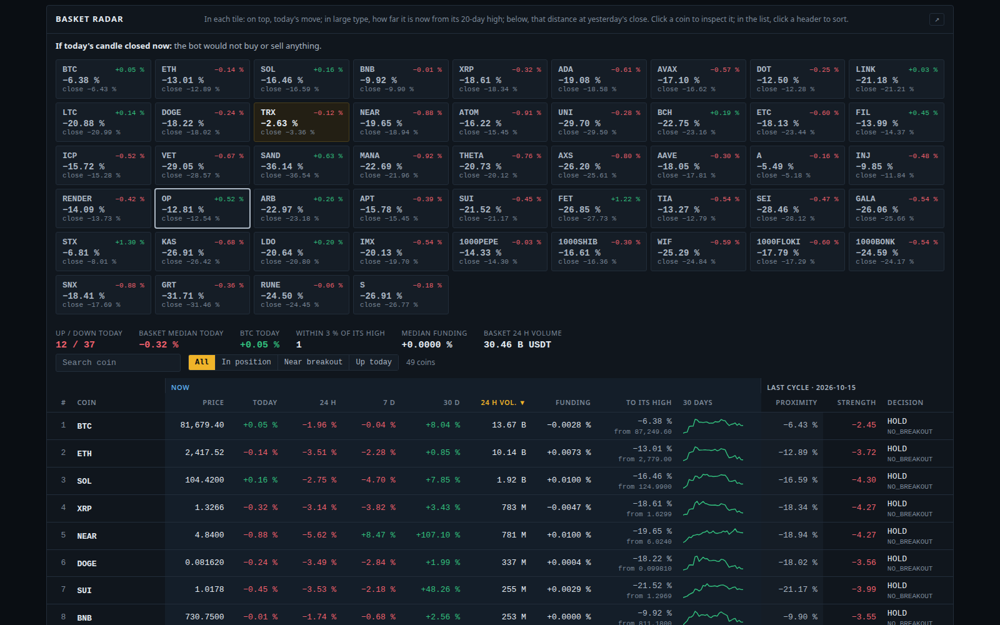
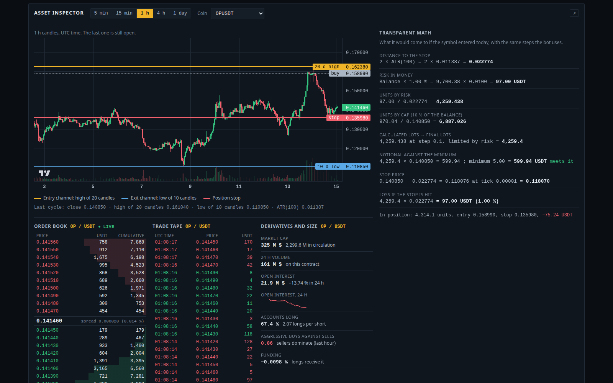
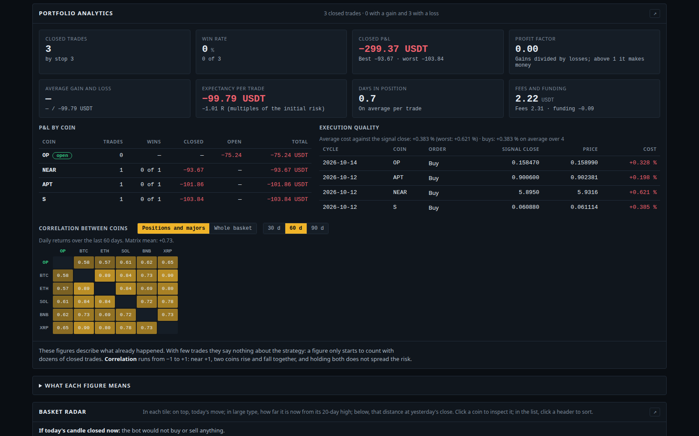
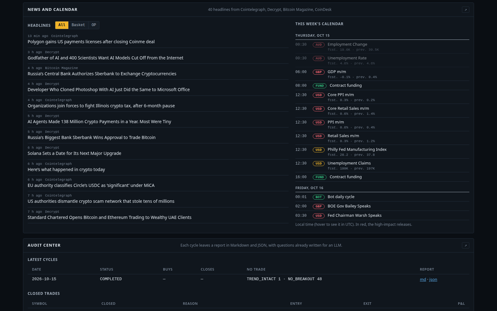
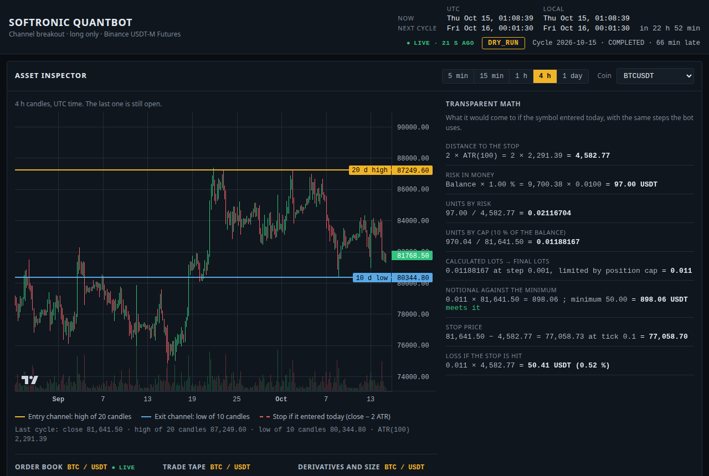

# Softronic QuantBot

A trading bot for Binance USDT-M perpetual futures. It runs once a day, trades a
basket of coins with a plain channel-breakout rule, keeps the risk of the whole
portfolio under a fixed ceiling, and comes with a read-only dashboard to watch
it work.



## Status: experimental

This started as an idea we wanted to test properly, and it is still that.

- The bot has been running in **dry run** (real prices, paper account) since
  October 2026. It has not traded real money.
- The strategy has historical backing only. Our own [research log](docs/research.md)
  counts about 695 comparisons on the same data and says plainly that no result
  in it is proof on its own.
- We are publishing it now so that anyone who wants to can run it on the
  Binance testnet, backtest it, read the code and tell us where it is wrong.

**This is not financial advice.** Nothing here is a recommendation to buy or
sell anything. Trading futures can lose money quickly. If you run this code
with real funds you do it at your own risk; see the [license](LICENSE) for the
absence of any warranty.

## What it does

Once a day, at 00:01:30 UTC, after the daily candle has closed:

1. It downloads the last 500 closed daily candles of every coin in the basket.
2. **Exits first.** A position is closed when the day closed below the low of
   the previous 10 candles. Each position also carries a stop, placed when it
   was opened, 2 × ATR(100) below the entry.
3. **Then entries.** A coin is a candidate when the day closed above the high
   of the previous 20 candles. Long only.
4. Candidates are ranked by how far they broke out, in ATRs, and each one is
   sized so that hitting its stop costs about 1 % of the balance, with no
   position larger than 10 % of the balance.
5. An entry is skipped if it would take the open risk of the portfolio above
   4 % of the balance or its notional above 1× the balance. Leverage is fixed
   at 1.
6. It writes a report of the day (Markdown and JSON) and, if configured, sends
   a Telegram message.

The same day is never run twice, an order that may have been sent is checked
before being sent again, and a position that could not be protected with a stop
is closed on the spot.

There are three modes:

| Mode | Prices | Orders | Needs |
|---|---|---|---|
| `DRY_RUN` (default) | Real | Simulated in a paper account kept on disk | Nothing |
| `TESTNET` | Testnet | Real orders on the Binance Futures testnet, play money | Testnet API keys |
| `LIVE` | Real | Real orders, real money | Live API keys and two separate switches |

## Quick start

With Docker:

```bash
git clone https://github.com/softronicve/Softronic-QuantBot.git
cd Softronic-QuantBot
docker compose up -d --build
```

The container runs in dry run and serves the dashboard on
`http://127.0.0.1:8770`. On a remote server, reach it through an SSH tunnel
(`ssh -L 8770:127.0.0.1:8770 user@server`); it is not meant to be exposed to
the internet. It only answers requests addressed to `localhost` or `127.0.0.1`,
so opening it through another hostname or a LAN address returns 403.

Without Docker (Python 3.12 or newer):

```bash
python -m venv .venv && . .venv/bin/activate
pip install -r requirements.txt
python -m src.engine.daily_runner --panel     # the cycle plus the dashboard
python -m src.engine.daily_runner --once      # run today's cycle now and exit
python -m src.ui.dashboard                    # the dashboard alone
```

If the cycle starts more than six hours after its scheduled time it still
closes what has to be closed, but it does not open new positions: by then the
price may be far from the close that gave the signal.

## Running it on the testnet

1. Create API keys at <https://testnet.binancefuture.com>.
2. Copy `.env.example` to `.env` and set:

   ```
   BOT_FUTURES__EXECUTION_MODE=TESTNET
   BOT_FUTURES__API_KEY=...
   BOT_FUTURES__API_SECRET=...
   ```

3. If you use the provided `docker-compose.yml`, change the mode there too and
   remove the two lines that blank the keys: as shipped, the compose file
   forces dry run whatever the `.env` says.

Be aware that the testnet and live paths have so far only been exercised
against a test double, not against a real account. That is one of the reasons
this is on GitHub.

`LIVE` needs `BOT_FUTURES__EXECUTION_MODE=LIVE`,
`BOT_FUTURES__LIVE_TRADING_ACKNOWLEDGED=true` **and** `BOT_DRY_RUN=false`. If
any of the three is missing the bot falls back to dry run. We do not recommend
it.

## Backtesting

The study that measures the rule without survivorship bias is in the
repository and uses the bot's own strategy, orchestrator and risk manager:

```bash
python -m src.strategies.research.basket_backtest download    # every USDT pair in the Binance archive, delisted ones included
python -m src.strategies.research.basket_backtest run          # default settings, point-in-time basket
python -m src.strategies.research.basket_backtest run --risk-pct 2 --max-position 0.2 --max-heat 8 --null 20
```

Each day it trades the twelve coins with the highest volume over the previous
30 days, using only what was known that day. It reports the result next to BTC
held at the same average exposure, buy and hold, and (with `--null`) random
entries. `--fixed` uses a fixed list of symbols, `--basket` changes the size
and `--cost` the fee per side. What it found is summarised in the
[research log](docs/research.md).

## Dashboard

A read-only page to follow the bot the way you would follow a trading desk. It
places no orders and changes nothing.

| Section | What it shows |
|---|---|
| Context strip | Crypto market cap, BTC dominance, fear and greed, S&P 500, Nasdaq, gold, oil, dollar index, US 10-year yield |
| Portfolio | Balance, equity at current prices, notional, portfolio heat and margin, with a glossary |
| Open positions | Entry price and date, current price, result, and the two levels at which each would be sold |
| Equity | The account cycle by cycle, its drawdown, and BTC at the same exposure as a yardstick |
| Analytics | Closed-trade statistics, result per coin, execution cost against the signal close, correlation matrix |
| Market | The basket as a sortable list: price, change today, 24 h, 7 and 30 days, volume, funding, distance to its high |
| Chart | Candles from 5 minutes to 1 day with the bot's levels; live order book, tape, open interest and positioning |
| News and calendar | Sector headlines filtered by coin, and the economic calendar of the week |
| Audit | History of cycles with each day's report |









There is a command line at the top (press `/`): `NEAR` opens that coin in the
chart, `NEAR 5M` opens it on 5-minute candles, `POS`, `EVO`, `ANA`, `MKT`, `GP`,
`NEWS` and `AUD` jump to each section, and `WIN GP` opens a section in its own
window. On the keyboard, `j` and `k` walk the list, `1` to `5` change the
candle interval and `?` shows the help. Every section can also be opened alone
in a separate window, which is handy with more than one monitor.



**Now and last cycle.** Decisions and positions are those of the last daily
cycle. Prices, the result of open positions and the "Now" columns of the market
list refresh every 10 seconds. Above the list the page says what would happen
if the day closed right now. That is a preview, not a decision: the bot only
acts on a closed daily candle.

**Where the data comes from.** Everything is public and needs no credentials.
If a source fails, the page shows the last thing it knew and carries on.

| Data | Source | Requested by |
|---|---|---|
| Reports, cycle candles, positions, trades | Files written by the daily cycle | The server, from disk |
| Prices, 24 h figures, funding, candles, derivatives, gold, oil and equity indices | Binance Futures public API | The server |
| Live order book and tape | Binance Futures public streams | Your browser |
| Market cap and dominance | CoinGecko | The server |
| Fear and greed index | alternative.me | The server |
| Dollar index and 10-year yield | Yahoo Finance | The server |
| Headlines | RSS feeds of CoinDesk, Cointelegraph, Decrypt and Bitcoin Magazine | The server |
| Economic calendar | ForexFactory | The server |

Set `BOT_FUTURES__PANEL_EXTERNAL_DATA=false` to keep the dashboard to what the
server itself reads from Binance: no headlines, no calendar, no third-party
figures, and the browser connects to nothing but the dashboard. Content from
outside is treated as untrusted: responses are size-capped, XML with entity
declarations is not parsed, headlines are written as text and only `https`
links are kept.

## Telegram alerts

After each cycle the bot can send what it did: buys with their stop, sells and
stops with their result, orders that did not go through, and how the account
stands. It also alerts once a day if the cycle cannot run.

1. Talk to `@BotFather` on Telegram, create a bot with `/newbot` and put its
   token in `BOT_TELEGRAM__BOT_TOKEN`.
2. Send any message to your bot, then run
   `python -m src.engine.notifier --chats`. It prints the
   `BOT_TELEGRAM__CHAT_ID` to use.
3. Restart the bot and check with `python -m src.engine.notifier --test`.

Without a token or a chat nothing is sent. An alert that fails is logged and
never stops the cycle.

## Configuration

Everything is set through environment variables or a `.env` file; see
[`.env.example`](.env.example) for the full list. The ones that matter most:

| Variable | Default | Meaning |
|---|---|---|
| `BOT_DRY_RUN` | `true` | Master switch. While true, nothing reaches a real account |
| `BOT_FUTURES__EXECUTION_MODE` | `DRY_RUN` | `DRY_RUN`, `TESTNET` or `LIVE` |
| `BOT_FUTURES__SYMBOLS` | 49 contracts | The basket, as Binance contract names (`1000PEPEUSDT`, not `PEPEUSDT`) |
| `BOT_FUTURES__RISK_PCT` | `1` | % of the balance at risk per position |
| `BOT_FUTURES__MAX_POSITION_FRACTION` | `0.1` | Largest position, as a multiple of the balance |
| `BOT_FUTURES__MAX_HEAT_PCT` | `4` | Largest open risk of the portfolio, in % |
| `BOT_PAPER_CAPITAL` | `10000` | Starting balance of the paper account |

The default basket is the twelve coins the rule was measured on plus 37 more
that we added to stress the code. The research log explains why the wider
basket is expected to do worse; `MEASURED_FUTURES_BASKET` in
`config/settings.py` is the twelve.

If you remove a coin from the basket while it has an open position, the cycle
keeps managing that position (exit channel and stop) until it is closed, and
does not buy it again.

## What the evidence says, in short

- On a basket of twelve coins chosen each day without looking ahead, delisted
  coins included, the rule turned 10,000 into 73,603 between 2019 and 2026 at
  0.3 % per side, with a 20 % maximum drawdown and about 20 % average exposure.
  BTC held at that exposure made about 23,700.
- It beat random entries in every run we made, but that test is not
  like-for-like and we say so.
- Half of the profit in the first backtest came from 5 trades out of 419. The
  rule trailed its passive benchmark in 2025 and 2026.
- A wider basket did worse. Doubling the risk raised return and drawdown
  together, with the same Sharpe ratio.
- Nothing passes a multiple-comparison correction, and there is no forward
  confirmation yet. That is what the dry run and the testnet are for.

The details, including what we tried and threw away, are in
[docs/research.md](docs/research.md).

## Project layout

```
config/settings.py                         Settings, read from BOT_* environment variables
src/engine/daily_runner.py                 The daily cycle: schedule, idempotence, dispatch
src/engine/orchestrator.py                 Exits first, candidates by strength, risk allocated one by one
src/engine/state_store.py                  Which cycles ran and what each order did
src/engine/daily_reporter.py               Daily audit report (Markdown and JSON)
src/engine/notifier.py                     Telegram alerts
src/strategies/trend_breakout.py           The 20/10 channel breakout, long only
src/strategies/research/basket_backtest.py Point-in-time backtest of the basket
src/risk/position_sizer.py                 ATR-based position sizing
src/risk/portfolio_risk.py                 Portfolio limits: notional and open risk
src/data/candle_loader.py                  Closed daily candles, checked before use
src/execution/binance_futures_executor.py  Account, contract rules, orders and stops; paper account
src/ui/                                    Dashboard: server, public market data, analytics, static page
tests/                                     Test suite
docs/research.md                           What was measured and what came out
```

## Tests

```bash
python -m pytest
```

The suite runs offline: the exchange, Telegram and every outside source are
replaced by test doubles.

## Contributing

Issues and pull requests are welcome, in particular reports from testnet runs,
holes in the research and anything in the accounting that does not add up.
`main` is protected, so changes go through a pull request.

Please do not open public issues that contain API keys, account ids or
anything else you would not want indexed.

## Third-party software and data

- Charts are drawn with [Lightweight Charts](https://github.com/tradingview/lightweight-charts)
  by TradingView, under the Apache License 2.0. A copy is vendored in
  `src/ui/static/`.
- Exchange access uses [python-binance](https://github.com/sammchardy/python-binance).
- Market data shown on the dashboard belongs to its sources, listed above.
  If you host the dashboard for other people, check their terms first.

This project is not affiliated with Binance or with any of those sources.

## License

[GNU Affero General Public License v3.0](LICENSE). In short: you can use,
study and change the code, and if you offer a modified version to others,
including as a network service, you have to publish your changes under the
same license.
